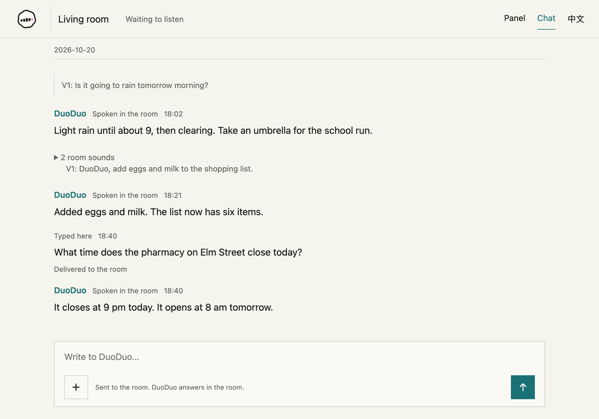
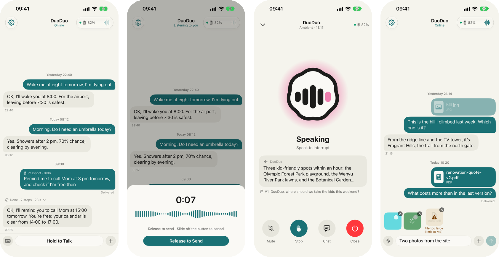
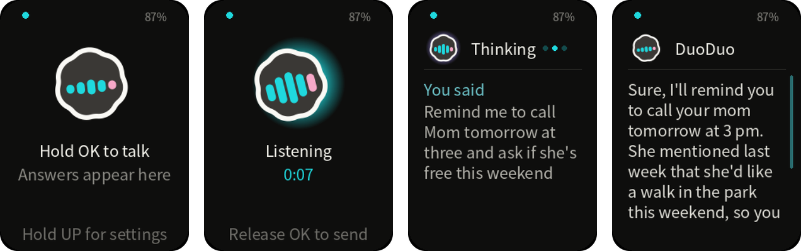

# ambient

Ambient is DuoDuo in a room: no app to open, no button to hold, no wake word. It hears everything
said in the room and answers only what was said to it. This repository holds the room channel for
the [duoduo](https://github.com/openduo/duoduo) daemon, its wire protocol, and the perception
service behind it. Product page: [openduo.ai/docs/channels#ambient](https://openduo.ai/docs/channels#ambient).

A browser page or an edge device holds the microphone and streams Opus packets to the channel. The
channel forwards them over one authenticated WebSocket to the cerebellum, a perception service. The
cerebellum detects voice presence, transcribes and diarizes each closed segment in one call, gives
the room's voices stable anonymous numbers from their voiceprints, and asks an LLM judge whether
what was just said was addressed to the agent. When it was, the channel submits the utterance to a
daemon session. The reply comes back as text on the page and as speech, synthesized by a cloud
realtime endpoint and played into the room.

## Ways to use it

- **A room that is always listening.** The capture page in a browser, or an edge device, holds the
  microphone all day. You host the cerebellum and its model services on one Linux machine with an
  NVIDIA card, following [docs/deploy.md](docs/deploy.md).
- **In your pocket.** The [DuoDuo Pocket](https://openduo.ai/docs/pocket) iPhone app, and a FoloToy
  AI Passport running the pocket firmware. Hold the button, say what you need, let go: each press
  is one push-to-talk voice note, always addressed to DuoDuo. The reply streams into the
  conversation on the phone and appears on the Passport screen. `room add --pocket` creates a room
  for it ([deploy.md §2b](docs/deploy.md#2b-create-a-room)).
- **Without a GPU.** Point the channel at a cerebellum someone else runs. The channel needs only its
  `wss://` URL and a token, and you skip the model services. Room audio then leaves your machine for
  theirs; see [deploy.md §2d](docs/deploy.md#2d-using-a-cerebellum-someone-else-runs).

## Quick start

With the [duoduo](https://github.com/openduo/duoduo) daemon installed:

```bash
duoduo channel install @openduo/channel-ambient
```

Or ask your duoduo: the `duoduo-ambient` skill walks it through installing the channel, connecting
a cerebellum, creating a room, and pairing the phone and the Passport. Install the skill with:

```bash
npx -y skills add https://github.com/openduo/duoduo --skill duoduo-ambient
```

[docs/deploy.md](docs/deploy.md) is the full runbook: the channel built from source, the room, the
model services, and the cerebellum.

<p align="center">
  
</p>

The room page above ships with the channel; it switches between English and Chinese from its
header. The same room can also be reached from the
[DuoDuo Pocket](https://github.com/openduo/pocket-ios) iPhone app and its push-to-talk accessory,
a FoloToy AI Passport running the [pocket firmware](https://github.com/openduo/pocket-passport):

<p align="center">
  
</p>
<p align="center">
  
</p>

## Layout

| path                        | what it is                                                                                                                                                                                                                                                                                            |
| --------------------------- | ----------------------------------------------------------------------------------------------------------------------------------------------------------------------------------------------------------------------------------------------------------------------------------------------------- |
| `packages/ambient-protocol` | The edge ⇄ channel ⇄ cerebellum wire contract: frame types, validators, and Opus packet duration. No runtime dependencies, and it never sees a daemon message.                                                                                                                                        |
| `packages/channel-ambient`  | The channel process. Serves the capture page, owns the capture seat and backpressure, dials the cerebellum, and talks to the daemon over JSON-RPC.                                                                                                                                                    |
| `packages/cerebellum`       | The perception and speech service. Voice presence, transcription, diarization, speaker numbering, the judge, and realtime synthesis, behind one address. The Node process itself needs no GPU, but it dials three GPU model services over loopback, so it lives on the GPU machine (see `services/`). |
| `services/`                 | The cerebellum's own control script, plus reference deployments of the upstream services it calls. Each upstream may be replaced by anything that honours its contract in [docs/service-contracts.md](docs/service-contracts.md).                                                                     |

The channel and the cerebellum are separate processes with separate hosting. The channel runs next
to the daemon; the cerebellum runs next to the model services it calls. The implementations under
`services/` are replaceable examples, not a requirement of the protocol.

## Requirements

Self-hosting the cerebellum takes one Linux machine with an NVIDIA card, Python 3.12, node, and
pnpm. One cloud credential is required, for speech synthesis; everything else is self-hosted. The
channel alone, pointed at a cerebellum someone else runs, needs no GPU.

The stack ships in two profiles, and the judge dominates both:

| profile         | ears, voiceprint, judge                                                                 | free VRAM                                   | free disk |
| --------------- | --------------------------------------------------------------------------------------- | ------------------------------------------- | --------- |
| **constrained** | a ggml ear and diarizer, the voiceprint encoder on its CPU provider, a small GGUF judge | ~4.5 GB on one card, measured               | ~10 GB    |
| **ample**       | a vLLM ear, the ggml diarizer, the encoder on CUDA, a 27B judge across two cards        | 29 GB of judge weights plus a pool you size | ~100 GB   |

Full numbers, per service, are in [docs/requirements.md](docs/requirements.md); the per-leg
reasoning is in [services/README.md](services/README.md#two-profiles).

## Bringing it up

[docs/deploy.md](docs/deploy.md) is a numbered runbook from an empty machine to a room that answers.
It opens by reading the machine - free VRAM per card, driver, docker, ports - and turning that into
a profile, then lists what only the machine's owner can supply, and only then installs: the daemon,
the channel, the three model services, the cerebellum, and the page. Each step names the command
that verifies it, and the last section maps the failure strings this code emits to their causes.

The judge can run on any OpenAI-compatible chat-completions endpoint. For one `sm_89` or `sm_86`
card, [docs/ambient-engine.md](docs/ambient-engine.md) builds an optional server for it from the
separate [`openduo/ambient-engine`](https://github.com/openduo/ambient-engine) repository.

## Status

Four things are explicitly provisional, and each says so where it is configured:

- The voice-presence operating point is the upstream vendor's stock values, adopted as a starting
  point. No labelled curve has been measured for a room.
- The voiceprint service's two execution providers are two embedding spaces on this encoder
  (cosine 0.9727 apart, deterministically), so the provider is part of the space's name. Choose it
  at install time; flipping it later archives a room's stored voices.
- The understander's faster speculative arm needs a container image that cannot be rebuilt from
  this repository. Bring the service up on the default arm, which needs no custom image.
- The judge doctrine was measured on the 27B reference checkpoint only. The constrained profile's
  small local judge, and any hosted OpenAI-compatible endpoint, are deployment-complete and
  quality-unmeasured; the request fields such an endpoint must accept are in
  [docs/service-contracts.md](docs/service-contracts.md).

## The openduo family

| project                                                               | what it is                                                                                                                                                    |
| --------------------------------------------------------------------- | ------------------------------------------------------------------------------------------------------------------------------------------------------------- |
| [openduo/duoduo](https://github.com/openduo/duoduo)                   | DuoDuo, a long-lived local runtime for Claude, Codex, Grok, and Pi, and its agent skills, including `duoduo-ambient` for this channel                         |
| [openduo/pocket-ios](https://github.com/openduo/pocket-ios)           | The DuoDuo Pocket iPhone app: one conversation with your DuoDuo, hold to talk, and the phone side of the Passport                                             |
| [openduo/pocket-passport](https://github.com/openduo/pocket-passport) | The Passport's pocket firmware, a fork of FoloToy's [folotoy/ai-passport](https://github.com/folotoy/ai-passport)                                             |
| [openduo/tether](https://github.com/openduo/tether)                   | Tether: any assistant can become DuoDuo. Connects Dots in ChatGPT, the Grok app, or an agent such as Claude Code to DuoDuo over MCP, approved by your passkey |
| [openduo/ambient-engine](https://github.com/openduo/ambient-engine)   | An optional judge server for one RTX 4090- or 3090-class card; see [docs/ambient-engine.md](docs/ambient-engine.md)                                           |
| [openduo.ai](https://openduo.ai)                                      | The DuoDuo site and documentation                                                                                                                             |

## License

Two licenses, split by boundary:

| path                        | license                                                                                                                                                                                                                                |
| --------------------------- | -------------------------------------------------------------------------------------------------------------------------------------------------------------------------------------------------------------------------------------- |
| `packages/ambient-protocol` | [Apache-2.0](packages/ambient-protocol/LICENSE). The wire contract is meant to be implemented by third-party edge devices and cerebellums, so it carries no use restriction.                                                           |
| everything else             | [FSL-1.1-Apache-2.0](LICENSE). Internal use, research, education and modification are permitted; offering the software as a competing product or service is not. Each version becomes Apache-2.0 two years after it is made available. |

Bundled third-party artifacts keep their own licenses, listed next to them, for example
[`packages/cerebellum/artifacts/silero-vad.LICENSE`](packages/cerebellum/artifacts/silero-vad.LICENSE).

The 多多 mark and the 多多 / DuoDuo and OpenDuo names are brand assets outside both licenses; see
[NOTICE](NOTICE).
